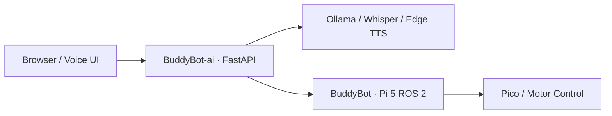

# BuddyBot-ai — Server-Side AI and Control

<div align="center">
  <p><a href="README.md">🇰🇷 한국어</a> · <strong>🇺🇸 English</strong></p>
  <p>  </p>
</div>

---

> Companion application for the physical [BuddyBot robot](https://github.com/rasasoe/BuddyBot). This repository runs on a **server PC**, not directly on the Raspberry Pi 5 or Pico.

## Responsibilities

| BuddyBot-ai server | BuddyBot robot repository |
| --- | --- |
| FastAPI, browser GUI, AI chat and monitoring | ROS 2 Jazzy and robot navigation |
| Browser-based speech I/O | LiDAR processing and person following |
| Whisper STT endpoint for Pi speech requests | Pi 5 ↔ Pico serial bridge |
| Edge TTS endpoint, time, weather, memory | RP2040 firmware and motor control |
| Checkpoint management APIs and high-level motion commands | Local obstacle avoidance and final command arbitration |



## Quick Start

Recommended: **Python 3.11+**; optional Ollama, weather API credentials and NVIDIA CUDA for larger Whisper configurations.

```bash
git clone https://github.com/rasasoe/BuddyBot-ai.git
cd BuddyBot-ai
bash scripts/setup_server.sh
source .venv/bin/activate
python -m uvicorn app.main:app --host 0.0.0.0 --port 8000
```

A local browser can open `http://127.0.0.1:8000`. Set optional API credentials and runtime settings in an uncommitted `.env` file.

## Architecture boundaries

The server can request manual movement, checkpoint navigation, and following mode. **It does not directly drive motors** or replace the robot-side ROS 2 and Pico firmware. The robot can demonstrate its offline base functionality without this optional server.

## Verification notes

The README describes the software integration and operational setup. Hardware accuracy, complete odometry and Kiwi-drive kinematic behavior still require real-world validation; server demonstrations do not themselves prove robot safety or navigation performance.

[Full Korean documentation / 한국어 설정 가이드](README.md) · [Robot repository](https://github.com/rasasoe/BuddyBot)

---

*BuddyBot-ai · Companion AI, Voice and Management Backend*
